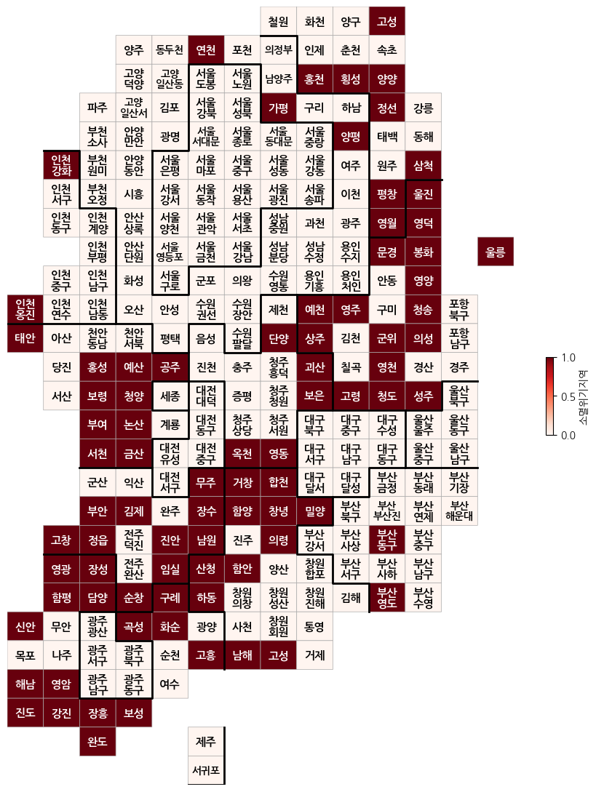
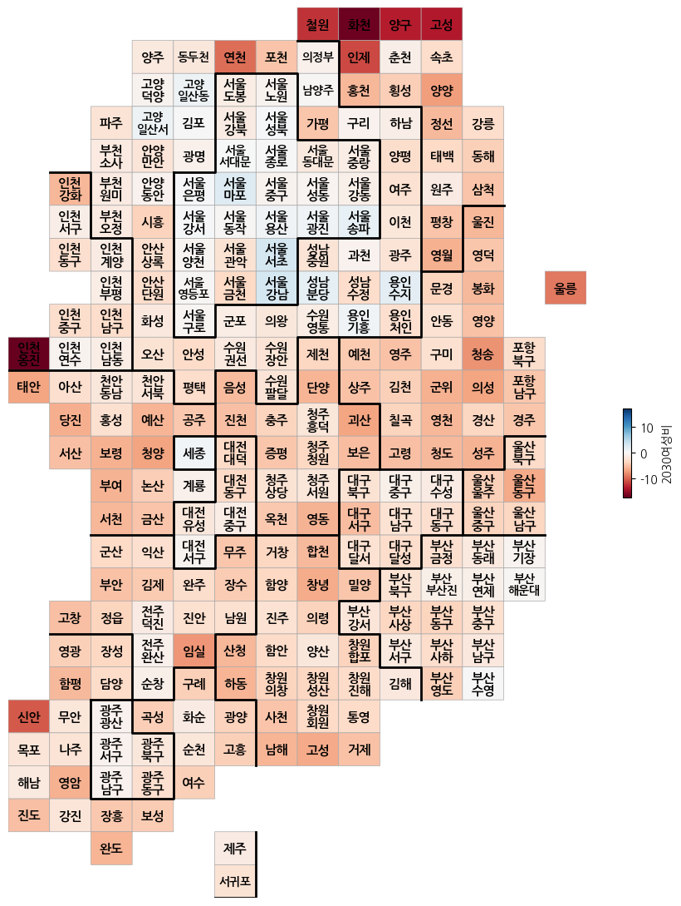
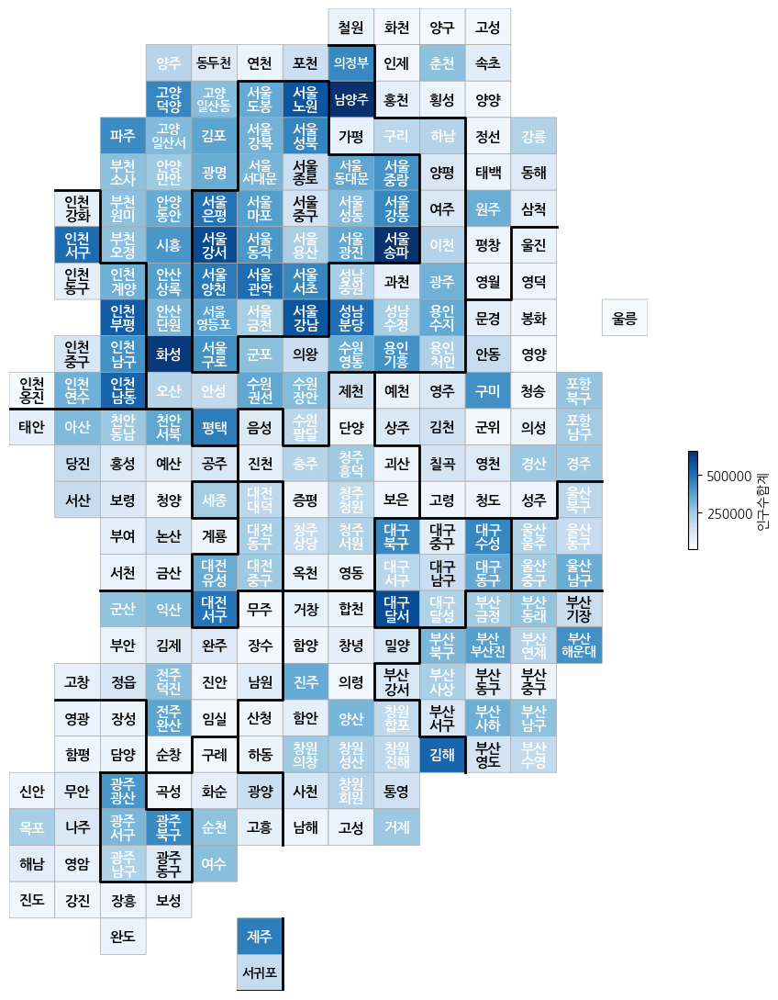

# data_visualization

시 · 군 · 구별 인구 데이터로 인구 소멸 위기 지역을 계산하고 지도로 그린 실습입니다.

책 『파이썬으로 데이터 주무르기』 5장의 예제를 따라 구현했습니다. 예제 코드와 데이터는 책의 공개 저장소([PinkWink/DataScience](https://github.com/PinkWink/DataScience))에 있습니다. 책의 코드를 지금 버전의 라이브러리로 돌리면 오류나 deprecated 경고가 나는 곳이 있어 그 부분을 고쳤습니다(예: `fillna(method='pad')` → `ffill()`, `map.choropleth()` → `folium.Choropleth()`).

  

소멸 위기 지역입니다. 짙은 칸이 소멸 비율 1.0 미만인 시 · 군 · 구입니다.

  
  

왼쪽은 20~39세 가운데 여성의 비율(붉을수록 여성이 적은 곳), 오른쪽은 인구수(짙을수록 많은 곳)입니다.

## 하는 일

1. **데이터 정리** — 행정구역별 인구 엑셀을 읽어 빈 칸을 채우고, 연령대를 20~39세와 65세 이상으로 묶어 지역별 피벗 테이블로 만듭니다.
2. **소멸 위기 지역 판정** — 소멸 비율 = 20~39세 여성 인구 ÷ (65세 이상 인구 ÷ 2). 이 값이 1.0보다 작으면 소멸 위기 지역으로 표시합니다.
3. **격자 지도** — 시 · 군 · 구를 같은 크기의 칸으로 놓은 지도에 인구수, 소멸 위기 지역, 여성 비율, 20~39세 여성 비율을 색으로 그립니다. 광역 경계선은 좌표 목록으로 직접 그립니다.
4. **단계구분도** — 행정구역 경계 GeoJSON과 folium으로 인구수와 소멸 위기 지역을 실제 지도 위에 그립니다. 이 지도는 노트북을 실행해야 보입니다.

## 파일

| 파일 | 내용 |
|---|---|
| `kor_population.ipynb` | 노트북(실행 결과 포함) |
| `population_raw_data.xlsx` | 행정구역별 · 성별 · 연령대별 인구 |
| `draw_korea_raw.xlsx` | 격자 지도의 칸 배치 원본 |
| `draw_korea.csv` | 위 배치를 지역 이름과 좌표(x, y)로 풀어 저장한 것 |
| `skorea_municipalities_geo_simple.json` | 시 · 군 · 구 경계 GeoJSON |
| `images/` | README에 넣은 격자 지도 세 장 |

데이터 파일은 책의 공개 저장소에서 받은 것입니다.

## 실행

Colab에서 만든 노트북이라 데이터 경로가 Google Drive 기준입니다. 다른 환경에서 돌리려면 첫 셀의 Drive 연결을 빼고 파일 경로를 바꿔야 합니다. 한글 글꼴(나눔)을 설치하는 셀을 돌린 뒤에는 런타임을 다시 시작해야 차트의 한글이 깨지지 않습니다.
